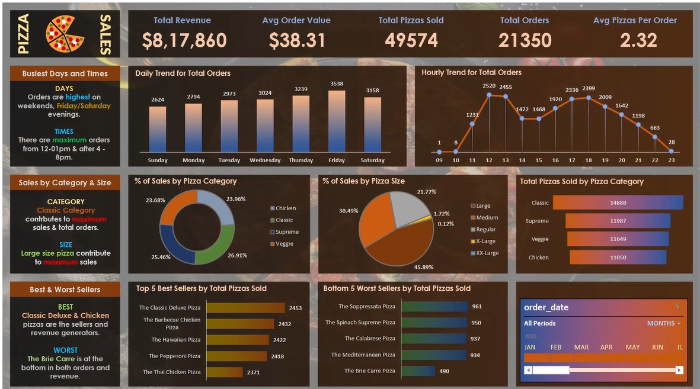

# Pizza-Sales-Analysis-With-SQL-EXCEL

OVERVIEW ANALYSIS : -

 

 ## 📌 Project Overview

This project focuses on analyzing pizza sales data using SQL and Microsoft Excel to identify sales trends, customer ordering patterns, revenue performance, and best- and worst-selling pizza products.

SQL queries were used to extract and analyze key business metrics, while Microsoft Excel was used to develop an interactive dashboard that presents the findings through KPIs, charts, and visualizations.

The dashboard helps understand business performance and provides insights that can support data-driven decision-making.

## 🎯 Project Objectives

  Analyze overall pizza sales and revenue performance.

  Identify daily and hourly order trends.

  Understand sales contribution by pizza category and size.

  Identify the best-selling and worst-selling pizza products.

  Track key performance indicators (KPIs).

  Build an interactive Excel dashboard for business reporting.

## 🛠️ Tools & Technologies

  | Tool | Purpose |
  |---|---|
  | SQL | Data extraction, querying, and analysis |
  | Microsoft Excel | Data analysis and dashboard development |
  | Pivot Tables | Data summarization and aggregation |
  | Charts & Visualizations | Sales trend and performance analysis |
  | Slicers & Filters | Interactive data exploration |

## 📈 Key Performance Indicators (KPIs)

  | KPI | Value |
  |---|---:|
  | Total Revenue | $817,860 |
  | Average Pizza Price | $38.31 |
  | Total Pizzas Sold | 49,574 |
  | Total Orders | 21,350 |
  | Average Pizzas Per Order | 2.32 |

 ## 🔍 Analysis & Dashboard Insights

1. Daily Trend for Total Orders

      Analyzed daily order distribution to identify the busiest days of the week.

      Friday and Saturday record the highest order volumes.

      Weekends show strong customer ordering activity.

2. Hourly Trend for Total Orders

      Examined order patterns across different hours of the day.

      Peak ordering activity occurs around lunchtime (12 PM–1 PM) and evening hours (5 PM–7 PM).

      Order volumes help identify high-demand business hours.

3. Sales by Pizza Category

      Analyzed the percentage contribution of each pizza category to total sales.

      Compared Classic, Supreme, Veggie, and Chicken categories.

      Identified the contribution of each category to overall sales.

4. Sales by Pizza Size

      Evaluated sales distribution across different pizza sizes.

      Compared Large, Medium, Regular, X-Large, and XX-Large pizzas.

      Identified customer preferences based on pizza size.

5. Best-Selling Pizzas

      Identified the top five pizzas based on total quantity sold.

      The Classic Deluxe Pizza ranks among the top-selling products.

      Other popular products include The Big Meat Pizza and The Hawaiian Pizza.

6. Worst-Selling Pizzas

      Identified the five lowest-selling pizzas to understand products with relatively lower demand.

      The Brie Carre Pizza is among the lowest-selling products.

      This analysis can help businesses review product demand and sales strategies.

## 💡 Business Recommendations

        Based on the dashboard analysis:

            Focus on inventory planning for high-demand days, especially Fridays and Saturdays.

            Ensure sufficient staffing during peak lunch and evening hours.

            Promote popular pizza categories and sizes.

            Review the performance of low-selling products and consider targeted promotions.

            Use sales trends to improve operational planning and inventory management.

## 📂 Repository Structure

   Pizza-Sales-Analysis/
   
   │
   
   ├── Dashboard/
   
   │   └── Pizza_Sales_Dashboard.xlsx
   
   │
   
   ├── SQL_Queries/
   
   │   └── Pizza_Sales_SQL_Queries.docx
   
   │
   
   ├── Dashboard.png
   
   │
   
   └── README.md

## 🏁 Conclusion

   This project provided an opportunity to apply SQL and Microsoft Excel for practical business data analysis. By using SQL queries to extract and analyze pizza sales data and Excel to     create an interactive dashboard, key insights were identified regarding revenue, sales performance, customer ordering patterns, and product preferences.

   The analysis highlights peak sales days and hours, popular pizza categories and sizes, and the best- and worst-selling products. These insights can help businesses improve inventory     planning, optimize operations, and make informed sales and marketing decisions.

   Overall, this project strengthened my skills in SQL querying, data analysis, Excel dashboard development, and business intelligence.

 ## Author
   [Ashwini Suryakar](https://www.linkedin.com/in/ashwini-suryakar/)
